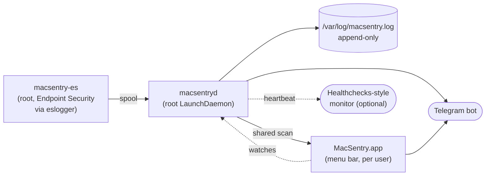

<div align="center">

# MacSentry

**Security alerts for your Mac, delivered to Telegram.**

[](https://github.com/vuminhhoa/macsentry/actions/workflows/ci.yml)
[](https://github.com/vuminhhoa/macsentry/actions/workflows/codeql.yml)
[](LICENSE)


English · [Tiếng Việt](README.vi.md)

</div>

MacSentry watches a Mac for remote access, persistence, tampering and security posture changes, and sends
each finding to Telegram as it happens, so the record leaves the machine before anyone can clean it up.
It is built for people who look after their own Mac, or a few machines, and want to know when something
changes without running a full EDR stack.

> [!NOTE]
> The app is available in English and Vietnamese (it follows the system language, or pick one in Settings).
> Telegram alerts from the daemon are still in Vietnamese; help translating them is welcome (see
> [Contributing](CONTRIBUTING.md)).

<p align="center">
  
</p>

## Highlights

- **Remote access**: SSH, Screen Sharing/VNC, Remote Desktop, SMB, AFP and Remote Apple Events sessions, with
  a popup for unknown IPs, reverse DNS and whois details, plus TeamViewer, AnyDesk, RustDesk, Chrome Remote
  Desktop and tunnels such as ngrok and cloudflared.
- **Persistence**: LaunchAgents/Daemons (including binaries swapped under an existing plist), Login and
  Background Items, configuration profiles, system extensions, kexts, authorization plugins, login hooks,
  trusted root CAs, browser extensions, cron, `sudoers`, PAM, `authorized_keys`, shell rc files, with diffs of
  what changed and secrets masked.
- **Endpoint Security**: failed authentication with the exact calling process, TCC grants (screen
  recording, accessibility, Full Disk Access, camera, microphone...), XProtect detections, Gatekeeper bypass,
  new users and admins, and dangerous commands such as reverse shells, keychain dumps, `curl | sh` and
  disabling SIP, Gatekeeper or the firewall.
- **Posture**: firewall, Gatekeeper, SIP, FileVault, automatic security updates, auto-login, Guest, screen
  lock, Find My, MDM, outdated XProtect.
- **Agents you rely on**: Wazuh (process, manager connection, configuration, active responses) and a built-in
  catalog of EDR, MDM, VPN and firewall agents, extendable through `/etc/macsentry.agents`.
- **Hard to silence**: a root daemon starts at boot, the menu bar app and the daemon watch each other,
  `kill -9` is reported, the log is append-only, and an optional heartbeat lets an outside service tell you
  when the Mac goes quiet.
- **Light on resources**: event driven (FSEvents, IOKit, DiskArbitration, SCDynamicStore, Endpoint Security),
  roughly 1-3% of one core in total, running at background priority. See [Performance](#performance).

See [docs/detections.md](docs/detections.md) for the full list.

## Screenshots

| Events | Connection history |
|---|---|
|  |  |
| **Trusted IPs** | **Settings** |
|  |  |

<sub>Screenshots use sample data and documentation IP ranges.</sub>

## How it works



| Component | Runs as | Role |
|---|---|---|
| `MacSentry.app` | user (LaunchAgent, restarted if killed) | Remote access popups, screen lock/unlock, camera and microphone, sleep; history, trusted IPs, event viewer and settings. |
| `macsentryd` | root (LaunchDaemon, from boot) | Most detections, the append-only log, Telegram delivery, the daily report and the heartbeat. |
| `macsentry-es` | root (LaunchDaemon, needs Full Disk Access) | Reads Endpoint Security events through `/usr/bin/eslogger` and hands them to the daemon. It never holds the Telegram token. |

More detail is in [docs/architecture.md](docs/architecture.md).

## Requirements

- macOS 26 (Tahoe) or later, on Apple silicon or Intel
- Xcode 26 or later, or the matching Command Line Tools (Swift 6)
- A Telegram bot token from [@BotFather](https://t.me/BotFather) and your chat ID

## Installation

MacSentry is built from source.

```sh
git clone https://github.com/vuminhhoa/macsentry.git
cd MacSentry
./build.sh                    # builds and installs ~/Applications/MacSentry.app, then starts it
```

1. Open **MacSentry → Settings**, enter the bot token and chat ID, and send a test message.
2. Install the root components:

   ```sh
   sudo ./daemon/install.sh
   ```

   The installer asks for an optional separate bot for the daemon (recommended, see
   [Security model](#security-model)), an optional heartbeat URL, and whether to monitor process execution.
3. Grant **Full Disk Access** to `/usr/local/libexec/macsentry-es` and `/usr/local/libexec/macsentryd`:
   System Settings → Privacy & Security → Full Disk Access → **+** → press <kbd>⌘</kbd><kbd>⇧</kbd><kbd>G</kbd>
   and paste the path. The daemon reminds you on Telegram until this is done.

To change the daemon's bot or heartbeat later, run `sudo ./daemon/install.sh --reconfigure`.

> [!TIP]
> If you have an Apple Development certificate in your keychain, `build.sh` signs with it, so macOS keeps
> Local Network and Full Disk Access permissions across rebuilds. Otherwise the binaries are signed ad hoc
> and the permissions must be granted again after each rebuild.

### Updating

The app checks GitHub for a new release once a day and notifies you. **Settings → Updates → Update…** opens
Terminal and runs the commands below in the source folder; you can also run them yourself:

```sh
git pull
./build.sh && sudo ./daemon/install.sh
```

### Uninstalling

```sh
./uninstall.sh            # removes the daemon (asks for sudo) and the app; keeps your data and the log
./uninstall.sh --purge    # also removes history, trusted IPs and the Telegram settings
```

The log at `/var/log/macsentry.log` is append-only by design. Remove it with
`sudo chflags nosappnd /var/log/macsentry.log && sudo rm /var/log/macsentry.log`.

## Configuration

| File | Purpose |
|---|---|
| `/etc/macsentry.conf` | Daemon settings (root only): `TOKEN`, `CHAT`, `HEARTBEAT_URL`, `ES_EXEC`, `FIM` |
| `/etc/macsentry.trusted` | Hosts a shell may connect to without a reverse shell alert |
| `/etc/macsentry.agents` | Extra agents to watch, on top of the built-in catalog |
| `/etc/macsentry.allow` | Regex allowlist for command alerts from the Endpoint Security helper |
| `~/Library/Application Support/MacSentry/` | App settings, connection history and trusted IPs (mode 0700) |

Every option is described in [docs/configuration.md](docs/configuration.md).

## Security model

MacSentry is a tripwire, not a shield. It tells you quickly and from outside the machine that something
changed; it does not block anything.

- **What it is good at**: catching remote access, persistence and configuration changes made by a person or
  by malware running as a normal user, and making them hard to hide, because the alert is already on your
  phone and the local log is append-only.
- **Use a separate bot for the daemon.** The app's token lives in your home folder, so anything running as
  you can read it and delete messages that bot sent in the last 48 hours. A daemon-only bot whose token is
  readable only by root keeps the daemon's alerts out of reach. The daemon tells you if both share a token.
- **Use the heartbeat.** If the Mac is wiped, powered off or the daemon is removed, the Mac cannot report it.
  A dead man's switch such as [healthchecks.io](https://healthchecks.io) can.
- **Limits**: an attacker with root can, in time, stop any local monitor, MacSentry included; what MacSentry
  adds is that the attempt is very likely to be reported first. It complements, and does not replace, an EDR,
  FileVault, regular updates and good account hygiene.

### Privacy

MacSentry has no server of its own and sends no analytics. Alerts go only to the Telegram chat you configure.
Alert text can include host names, user names, IP addresses, command lines and (masked) file diffs, so treat
the chat as sensitive. To describe remote peers, the daemon runs `whois` and reverse DNS for their IPs, which
sends those IPs to the relevant registries and resolvers. The heartbeat, if set, is a plain request to the URL
you choose.

## Performance

Measured on a busy development Mac (IDE, builds, many processes):

| Component | CPU (one core) | Notes |
|---|---|---|
| `macsentryd` | ~0.4-0.8% | Event driven; the earlier shell version used ~4.5% |
| `macsentry-es` + `eslogger` | ~2% | Mostly `exec` events; set `ES_EXEC=0` to turn them off |
| `MacSentry.app` | ~0.2% | Reuses the daemon's scan; camera and microphone through listeners |

Both root jobs run with `ProcessType=Background` and `LowPriorityIO`, so macOS throttles them in favour of
your work. Alerts may arrive a few seconds late while the machine is busy.

## Development

```sh
./build.sh --no-install                         # build into build/ without touching the installed app
ARCHS="arm64 x86_64" ./build.sh --no-install    # universal build, as CI does
```

Run the daemon without root and without sending anything:

```sh
DRYRUN=1 CONF=./test.conf LOG=./test.log STATE=./state PUB_DIR=./pub build/macsentryd
```

Replay recorded Endpoint Security events through the helper:

```sh
STATE=./state build/macsentry-es --replay < events.jsonl
```

Inspect what the daemon's readers see, without sending anything: `sudo /usr/local/libexec/macsentryd --check`.

The source layout and how to add a new check are described in [docs/architecture.md](docs/architecture.md).

## Further reading

Write-ups on how MacSentry is built and why, on [vuminhhoa.com](https://vuminhhoa.com/en/projects/macsentry):

- [Making a Mac security monitor hard to silence](https://vuminhhoa.com/en/blog/tamper-resistant-mac-security-monitor)
- [From a polling Bash script to an event-driven Swift daemon on macOS](https://vuminhhoa.com/en/blog/macos-daemon-bash-to-swift-event-driven)
- [Endpoint Security on macOS without the entitlement: eslogger and Swift](https://vuminhhoa.com/en/blog/endpoint-security-eslogger-swift)

## Contributing

Bug reports, false positive reports, new detections and translations are welcome. Please read
[CONTRIBUTING.md](CONTRIBUTING.md) first, and report vulnerabilities privately as described in
[SECURITY.md](SECURITY.md). This project follows the [Contributor Covenant](CODE_OF_CONDUCT.md).

## License

[MIT](LICENSE) © 2026 Vũ Minh Hoà
